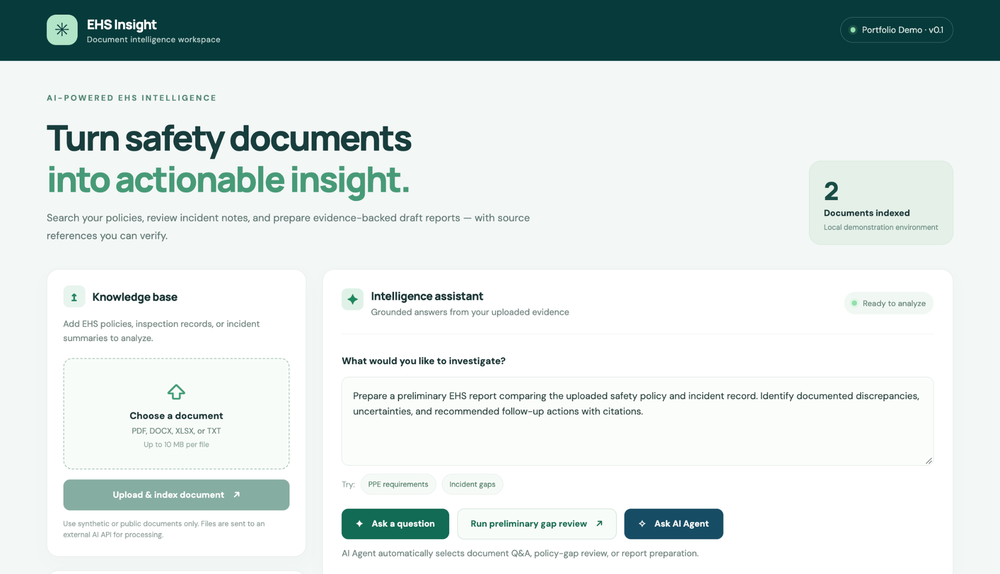
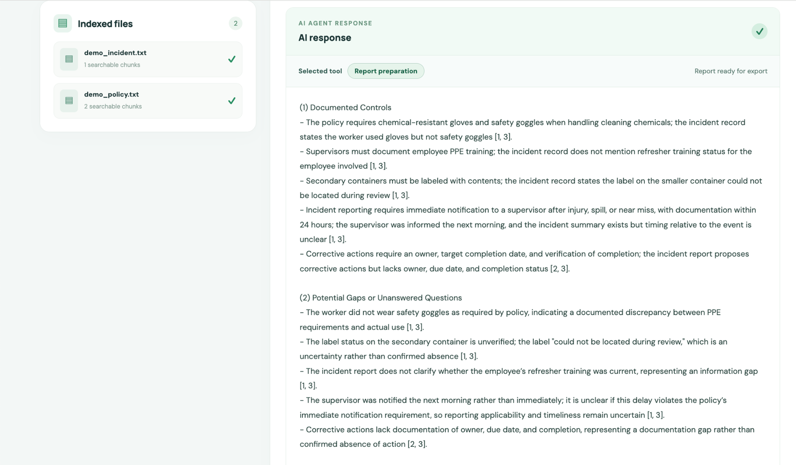
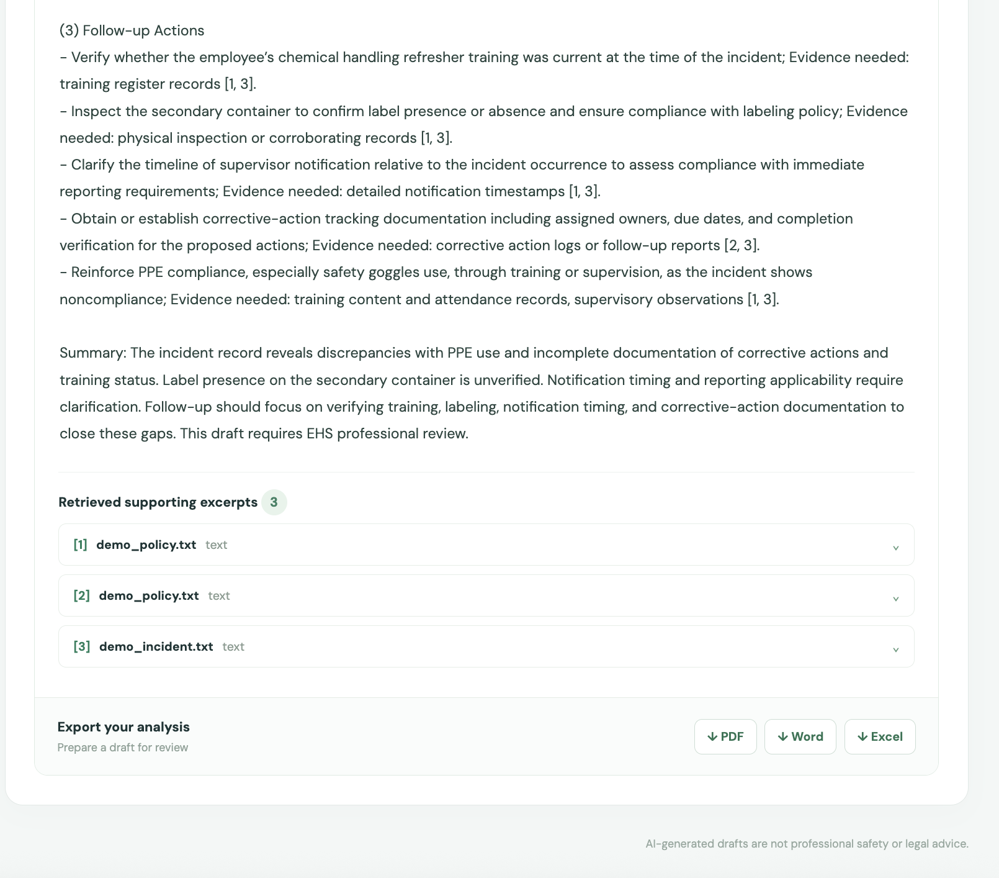

# EHS Insight — AI Document Intelligence Assistant

**A full-stack, source-grounded EHS document analysis portfolio project.**

EHS Insight helps reviewers search environmental, health, and safety (EHS) policies and incident notes, identify potential documentation gaps, and prepare draft reports with evidence excerpts for human verification. It is a **local demonstration**, built with synthetic example documents—not a compliance decision engine.



## Demo in 60 seconds

1. Upload `samples/demo_policy.txt` and `samples/demo_incident.txt`.
2. Ask the **AI Agent**: *“Prepare a preliminary EHS report comparing the uploaded safety policy and incident record. Identify documented discrepancies, uncertainties, and recommended follow-up actions with citations.”*
3. See the selected tool, read the generated review, and expand the numbered evidence excerpts.
4. Export the result to **PDF, Word, or Excel**. In Excel, review the **Analysis**, **Findings**, **Follow-up Actions**, and **Evidence** worksheets.



> **Important:** This prototype does not determine legal compliance, certify safety, or replace qualified EHS reviewers. Only upload synthetic or public information: extracted text is sent to external OpenAI embedding/LLM services. The app is not hardened for sensitive organizational data or public hosting.

## Features

| Capability | Implementation |
|---|---|
| Document ingestion | PDF, DOCX, XLSX, and TXT; max 10 MB per file; scanned PDFs/OCR not supported |
| Search and retrieval | LangChain text chunks, OpenAI embeddings, local persistent Chroma |
| Duplicate prevention | SHA-256 fingerprint checked against SQLite metadata before new embeddings are created |
| Grounded Q&A | Retrieves source passages and returns numbered evidence markers and excerpts |
| Preliminary gap review | Separates documented controls, possible discrepancies, missing evidence, and follow-up questions |
| Bounded AI agent | LLM selects **one** permitted tool per request: document Q&A, policy-gap review, or report preparation |
| Reliability checks | Targeted checks for known misleading claims (injury status, unverified labeling, reporting applicability); at most one correction retry |
| Report export | PDF, DOCX, and XLSX with citations; Excel includes grouped-citation parsing and citation-presence checks |
| Developer workflow | FastAPI/OpenAPI, Vue 3 + TypeScript + Vite, pytest, GitHub Actions |

**Agent scope:** This is *model-directed tool selection* with one tool invocation per request. It is not an autonomous planner, general-purpose agent, or multi-step tool executor. Reports are prepared as drafts; the user explicitly chooses whether to download one.

## Technology stack

- **Frontend:** Vue 3, TypeScript, Vite
- **Backend:** Python, FastAPI, Pydantic
- **AI / RAG:** LangChain, OpenAI chat model and embeddings, ChromaDB
- **Storage:** SQLite for document metadata; Chroma for vectors and retrieved text
- **Processing / exports:** pypdf, python-docx, pandas, openpyxl, ReportLab
- **Quality checks:** pytest, source-citation auditing, targeted regression tests, GitHub Actions

See [Architecture & design decisions](docs/architecture.md) for the component diagram, data flows, tradeoffs, and limitations.

## Quick start (macOS / Linux)

**Prerequisites:** Python 3.11 or newer, a compatible Node.js version for Vite 8 (Node.js 20.19+ or 22.12+), and an **OpenAI API key with API billing enabled**. API billing is separate from a ChatGPT subscription.

Clone the repository:

```bash
git clone https://github.com/CoryOr/ehs-ai-document-intelligence.git
cd ehs-ai-document-intelligence
```

**Terminal A — backend**

```bash
python3 -m venv .venv
source .venv/bin/activate
python -m pip install -r backend/requirements.txt
cp .env.example .env
# Open .env in your editor and replace the placeholder OPENAI_API_KEY.
cd backend
python -m uvicorn app.main:app --reload --port 8000
```

The application loads `.env` from the repository root when launched from `backend/`. Do **not** push your `.env` file to Git. Test the API at http://127.0.0.1:8000/docs or http://127.0.0.1:8000/api/health.

**Terminal B — frontend**

```bash
cd frontend  # From repository root
npm install
npm run dev
```

Open http://localhost:5173. Vite forwards the `/api` paths to the FastAPI development server. If it is already running, do not start a second server on the same port.

**Run checks:**

```bash
# From repository root, with the Python environment activated:
cd backend
python -m pytest -q

# In another terminal or after returning to repository root:
cd ../frontend
npm run build
```

> **Branch status:** The tested AI Agent and Vue integration have been merged into the default `main` branch. You can clone and run `main` directly; no branch switch is needed. GitHub Actions checks passed on the feature pull request and merge (October 23, 2026).

## How the agent works

1. Users upload a file; FastAPI extracts text, chunks it, creates embeddings, and stores vectors in Chroma. SQLite tracks uploaded document metadata and fingerprints.
2. For an AI Agent request, the LLM routes the user's request to **exactly one** allowed tool:
   - `answer_document_question`
   - `review_policy_gaps`
   - `prepare_report`
3. The selected tool invokes the existing RAG/review workflow, retrieves context, and generates a draft answer with source markers.
4. Targeted source-aware reliability rules may request **one** correction. Citations refer to returned excerpts, not a guarantee of factual correctness.
5. When a report draft is ready, the Vue UI offers explicit PDF, Word, and Excel downloads.

## API endpoints

| Method | Route | Purpose |
|---|---|---|
| GET | `/api/health` | Health check |
| GET | `/api/documents` | Indexed-document metadata |
| POST | `/api/upload` | Upload and index a document (`file` multipart field) |
| POST | `/api/chat` | Evidence-grounded question (`question`) |
| POST | `/api/analyze` | Preliminary gap review (`focus`) |
| POST | `/api/agent` | Select an approved tool (`request`) |
| POST | `/api/export` | Generate PDF, DOCX, or XLSX from supplied answer and sources |

## Test evidence and evaluation

The project contains pytest regression coverage for duplicate uploads, grouped citation markers, the bounded agent router, and specific false-claim patterns. The developer reported **66 passing backend tests** before the later grouped-citation addition; the grouped-citation tests and a new Excel export were also exercised. This does not imply that all model responses are factually correct or that a final post-documentation CI run has already passed.

Read the [evaluation notes](docs/evaluation-notes.md) for observed live scenarios versus checks still pending. Re-run `python -m pytest -q` and `npm run build` before presenting any new final test count.



## Limitations and responsible use

- **Human review required:** AI-generated output is preliminary and must not be treated as a legal, safety, or regulatory determination.
- **Citations are not truth verification:** The Excel citation audit checks marker presence and rough filename-derived source categories, not whether every claim is supported.
- **Reliability checks are narrow:** Pattern-based checks cover observed failure cases; a cautious response can still be wrong.
- **Prompt injection and privacy:** Retrieved documents are treated as untrusted, but there is no full prompt-injection defense, authentication, tenant isolation, file antivirus scanning, or production access control.
- **RAG limits:** No OCR for scanned PDFs; no measured retrieval ranking benchmark, confidence calibration, or robust query-time file scoping.
- **Operational limits:** Local SQLite/Chroma storage, synchronous API calls, external API dependencies and costs. Not publicly deployed as a hosted service.

## Portfolio materials

- [Architecture and engineering tradeoffs](docs/architecture.md)
- [90-second demonstration script](docs/demo-script.md)
- [Evaluation notes and honest test results](docs/evaluation-notes.md)
- [Day 3 finalization checklist](docs/day3-portfolio-checklist.md)
- [Portfolio and resume project descriptions](docs/portfolio-description.md)

**License:** MIT. Sample documents are synthetic and meant for demonstration only.
