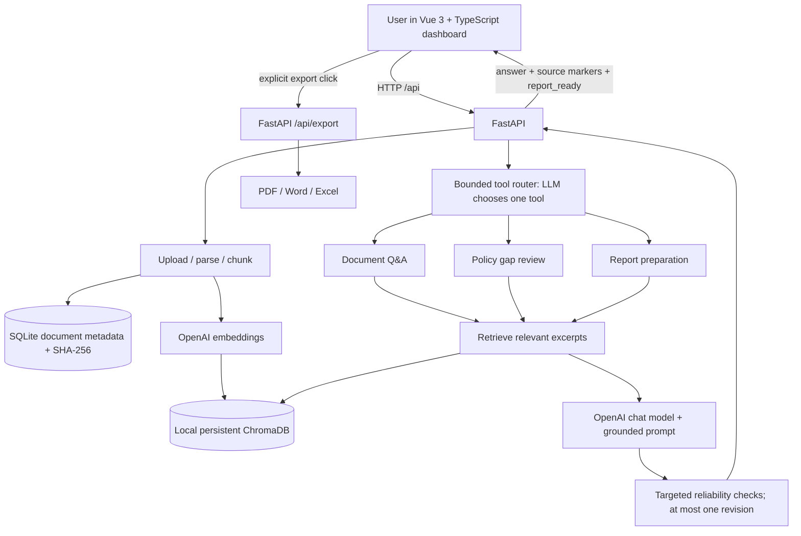

# System architecture and engineering decisions

## At a glance

This diagram describes the version merged into the default **`main`** branch as a local demonstration. It is a *single-decision tool router*, not an autonomous multi-step agent or external-action system.

## Request flows

### Upload

1. FastAPI checks file extension, emptiness, and maximum size (10 MB).
2. A parser extracts text from PDF, Word, Excel, or UTF-8 TXT; scanned/image-only PDFs require OCR and are not supported.
3. The SHA-256 digest of the original bytes is checked against an indexed SQLite column to skip repeated uploads.
4. LangChain splits pages/sheets/text into chunks (configured around 850 characters with 120-character overlap).
5. OpenAI generates embeddings; Chroma persists vectors and chunk metadata. SQLite records the document ID, filename, and chunk count after vector insertion. Cleanup is best-effort if a later step fails.

### Ask AI Agent

1. FastAPI validates the user request and checks that documents exist.
2. The router LLM is bound to exactly three approved tools and required to choose one.
3. Backend ignores model-supplied tool arguments and passes the original user request to the chosen tool.
4. Q&A, review, and report tools reuse the source-grounded RAG implementation. Retrieval uses Chroma similarity search.
5. Targeted regex-based checks can identify previously observed unsafe conclusions and prompt one revision. They are *not* semantic fact verification.
6. Response includes `tool_used`, `answer`, `sources`, `report_ready`, and `title`. PDF/Word/Excel export is user-initiated and handled separately.

### Citation and export

Each evidence marker points to a retrieved text chunk, with source filename, locator, and excerpt. The Excel exporter recognizes both `[1][3]` and grouped `[1, 3]` references. Its Findings and Follow-up Actions sheets distinguish valid markers from missing or unrecognized references. Citation correctness beyond marker matching requires human inspection.

## Why these design choices?

| Decision | Benefit | Tradeoff |
|---|---|---|
| Local SQLite and ChromaDB | Small setup, reproducible demo without external database provisioning | No multi-tenant isolation, backup plan, or production scaling |
| SHA-256 duplicate detection | Avoids unnecessary embeddings for identical bytes | Different bytes representing the same content are not deduplicated |
| Retrieval before answering | Source excerpts support reviewable output | Retrieval quality is imperfect; no measured relevance threshold |
| Single-tool LLM router | Demonstrates real tool selection with bounded side effects | Cannot plan and execute multi-stage tool sequences |
| One revision on targeted flags | Prevents known wording failures without unbounded retry cost | Rules can miss failures or create false positives |
| Structured Excel export | Findings/action/evidence rows support business workflow | Source-role labeling relies on filenames; no full semantic claim validation |

## Security and operational boundaries

- Intended for **synthetic/public demo documents only**. Uploaded content is processed by an external AI API; don't ingest proprietary client data.
- `.env` is ignored by Git. Never commit API keys, personal documents, or the local vector/database store.
- There is no built-in authentication/authorization, content virus scanning, quota enforcement, or secure multi-user storage.
- Treat retrieved document text as **untrusted input**: the current model prompt restricts document instructions, but additional prompt-injection testing would be required before production usage.
- Model output is for draft analysis only. A professional must verify evidence and assess any regulatory requirements.

## Deployment plan (not deployed)

For a future hosted demonstration: separate the API and frontend, enforce auth and uploaded-file isolation, switch to managed/isolated persistence, scan and limit uploads, store secrets in a manager, secure HTTPS and logging, set LLM budget limits, add telemetry and retrieval evaluations, and run CI plus end-to-end smoke tests. **Do not deploy the current local demo directly on the public internet.**
